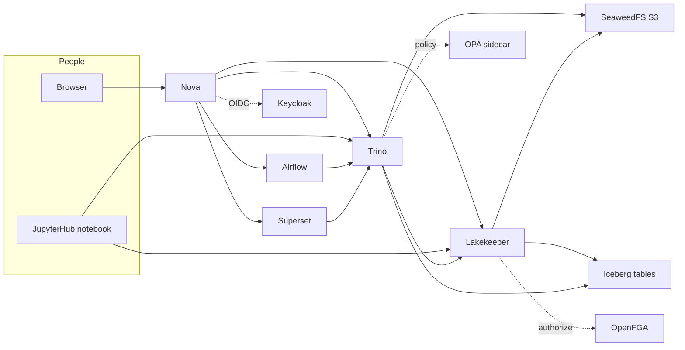

# stardelt Architecture

**stardelt is an opinionated collection of open-source services, shipped together as a Kubernetes-native data platform.** You bring the Kubernetes cluster; stardelt installs and wires the services that turn it into a lakehouse, a streaming platform, a notebook environment, and a BI surface — under a single UI.

## Stack at a glance

| Layer | What it is | Services |
|---|---|---|
| Control plane | the CRDs and the UI that plan and observe everything | [stardelt Operator](../services/operator), [stardelt Nova](../services/nova) |
| Data plane | storage, the catalog, the query engine | [SeaweedFS](../services/seaweedfs), [Lakekeeper](../services/lakekeeper), [Apache Iceberg](../architecture/services), [Apache Trino](../services/trino) |
| Applications | opt-in workloads over the same storage | [Apache Airflow](../services/airflow), [Apache Superset](../services/superset), [JupyterHub](../services/jupyterhub), [Apache Spark (Spark Connect)](../services/spark) |
| Platform services | identity, policy and secrets the others depend on | [Keycloak](../services/keycloak), [OpenFGA](../services/openfga), [Open Policy Agent (OPA)](../services/open-policy-agent) (the Lakekeeper sidecar), [OpenBao](../services/openbao), [CloudNativePG](../architecture/services) |



<!-- No logo assets or brand palette: service names and marks are trademarks and adding a logo wall needs a maintainer decision. -->

## What's in the box


*The target architecture — it names services that are
specified but not built yet. [Services](./services) is the honest list of what an install contains
today; the [roadmap](../roadmap) carries the phasing.*

### Kubernetes — the platform you bring

stardelt is *not* a Kubernetes distribution. Any conformant cluster works: EKS, GKE, AKS, OpenShift, Rancher RKE2, k3s, or a sovereign-cloud K8s (STACKIT, OVHcloud, IONOS, Hetzner, Open Telekom Cloud, Scaleway). Supported versions: current N and N-1.

### Core profile

The always-installed services that define stardelt. See [Services](./services) for the current list and links.

### Optional components

Services you can enable on top of the core, off by default. See [Services](./services) for what is available and how to turn each on.

### Planned services

Services designed for later phases but not in the install path yet. See [Services](./services) and the [roadmap](../roadmap).

## How the services connect

The canonical lakehouse read path:

```text
   client (BI / notebook / Spark job)
                │
                │  query
                ▼
   ┌──────────────────────────┐
   │  Trino  /  Spark Connect │
   └────────────┬─────────────┘
                │  Iceberg REST + OIDC token
                ▼
   ┌──────────────────────────┐
   │       Lakekeeper          │
   │  (Iceberg REST catalog)   │
   └────────────┬─────────────┘
                │  table metadata + short-lived S3 creds
                ▼
   ┌──────────────────────────┐
   │        SeaweedFS          │
   │   (or BYO S3-compatible)  │
   └────────────┬─────────────┘
                │  Parquet files
                ▼
            (read by engine)
```

When the streaming service (P3) is enabled, Apache Kafka carries event topics that Flink processes into Iceberg tables; the base install needs no Kafka — Airflow writes batch results straight to Iceberg. JupyterHub talks to Trino for SQL and to Spark Connect for heavier compute; Superset talks to Trino for dashboards.

Sign-in is a plug per install. With `identity.mode: platform` the chart deploys Keycloak and Nova and Trino sign people in through it; `external` points them at your own OIDC provider; `none` (the chart default) keeps the development authentication. The vended-credential step in the diagram is the target design: today Trino reads and writes S3 with the static credentials from the `stardelt-s3-creds` Secret (`vended-credentials-enabled=false` in `helm-values/trino.yaml`).

## Operating model

stardelt follows the **operator-per-service pattern**: each service is managed by its own well-maintained upstream operator (Strimzi for Kafka, Spark Operator for Spark, CloudNative-PG for Postgres backing Lakekeeper, etc.). On top sits the **stardelt Operator**, which reconciles a small set of top-level CRDs into the per-service CRDs underneath. Operators run as standard Kubernetes controllers — no SaaS side, no phone-home.

## Multi-tenancy

One `PlatformInstance` per platform. Data domains and compute are segregated by `Catalog` and `SqlWarehouse` resources with owner groups; audit events carry the acting identity. No `NetworkPolicy` is installed yet: treat the namespace as flat.

## Sovereignty

[Full commitments in SOVEREIGNTY.md.](sovereignty.md) Architectural enforcement:

- **No mandatory outbound calls.** Every release ships a documented network-egress matrix.
- **Air-gap install profile.** All images at `ghcr.io/stardelt/...` plus mirrors; `images.tar` bundle ships with each release.
- **No license server.** There isn't one. There will never be one.
- **Opt-in telemetry only.** Off by default.

## Compliance

stardelt is *evidence-gathering infrastructure*, not a certified product. Later phases ship control-mapping starter kits for SOC2, ISO27001, BSI C5, and FedRAMP-on-your-own-cluster. Certifications remain the operator's responsibility.

## Out of scope / non-goals

Being explicit about what the core stack will *not* contain saves everyone a design debate later.
What stardelt is not is a deliberate choice; this is the concrete consequence for service selection.

**Hadoop-era services are out of scope for the stardelt core stack:**

| Not included | Instead | Why |
|---|---|---|
| **HDFS** | SeaweedFS (S3 API), or your own S3-compatible store | The data plane is object storage behind the S3 API; Iceberg tables live on it. A block-oriented filesystem with NameNode semantics adds a stateful failure domain and a second storage abstraction for no benefit. |
| **Hive Metastore as the primary catalog** | **Lakekeeper** (Iceberg REST); the plug matrix lists Apache Polaris and Gravitino as alternates | The catalog contract is the Iceberg REST spec. A Hive Metastore-backed catalog is neither the default nor an alternate in the plug matrix, and nothing in the stack depends on one. |
| **YARN** | Kubernetes (scheduling), Trino and Spark Connect (execution) | stardelt runs on a cluster you already operate. Adding a second scheduler means two places to enforce policy, quota, and identity — the exact fragmentation the platform exists to remove. |
| **ZooKeeper** | Kafka in KRaft mode (via Strimzi) | Kafka has not needed ZooKeeper for metadata since KRaft. See [Services](./services). |

Two qualifications, so this is not read as a ban on interoperability:

- **Reading old data.** Iceberg's own migration paths, and engines that can attach an external
  metastore, are a customer decision. stardelt does not ship, wire, or support HDFS or a Hive
  Metastore as part of the platform.
- **Consuming upstream services.** If a legacy system speaks S3 or the Iceberg REST protocol, it can
  read the lakehouse like any other client. That is a property of the contracts,
  not a stardelt feature.

This follows from the two principles that decide service selection: **Iceberg is the spine**, and
services must be *modern architecture — not Hadoop/HDFS heritage* (see [Service selection
criteria](./services.md#service-selection-criteria)). A component that cannot be described as a plug
behind a CRD or a published spec does not enter the core stack, whichever era it comes from.
