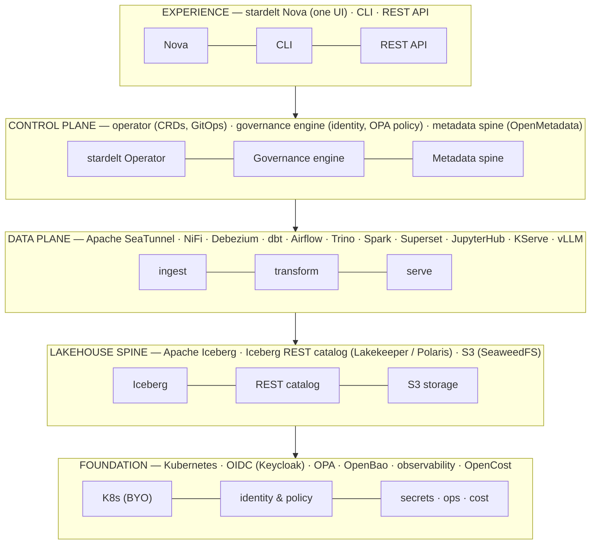

# stardelt Master Spec

**The one document that defines what stardelt is, what it builds, and what it deliberately never builds.** Everything else — the roadmap, the service catalog, the code — derives from this. When documents conflict, this one wins. Changes to this spec require a pull request and a discussion period.

:::info Status
Pre-alpha design authority. This document is the anchor for recruiting contributors: read this first, then the [architecture overview](../architecture/overview) and the [roadmap](../roadmap).
:::

## 1. What stardelt is

**stardelt is a sovereign, self-hostable, on-prem data platform — the open alternative to Databricks and Microsoft Fabric for organizations that must keep their data under their own control.**

One sentence of architecture: an opinionated **control plane** (CRD-based operator + the Nova UI + a governance spine) over a **curated, contract-pluggable set of best-of-breed open-source services**, with **Apache Iceberg as the data spine** and **one identity and policy model enforced at the catalog**.

It is a full data platform in one place: ETL and ingestion, lakehouse storage, transforms, data engineering, analytics, BI — with AI capabilities that run air-gapped.

## 2. The problem we solve

Enterprises are not short of tools. The open-source world already has every piece of a modern data platform — a table format, engines, orchestrators, connectors, catalogs, BI. What it does not have is **integration**:

- Every tool brings its own identity model, its own metadata silo, its own install path, its own upgrade cadence.
- A corporate platform team assembles them into "47 YAMLs" of glue, then owns that glue forever.
- The proprietary vendors (Databricks, Fabric, Snowflake) win not on engines but on **one identity, one catalog, one governance model across all workloads**.

For EU companies (CLOUD Act, Schrems II), regulated industries, defense and public sector, there is no assembled-on-prem answer at all.

**The gap is the integration layer. So the integration layer is the product.**

## 3. The core insight: contracts + defaults + glue

stardelt does not build engines. It builds the **contracts**, the **opinionated defaults**, and the **glue** that make best-of-breed OSS behave like a single platform.

This is the Kubernetes pattern, applied to data infrastructure. Kubernetes is pluggable through specs (CRI, CNI, CSI) but every cluster ships a default implementation. Nobody calls Kubernetes "unopinionated" — and nobody forks the cluster to swap a network plugin.

- **Contracts.** Every domain is abstracted behind a specification: the Iceberg REST catalog spec, a stardelt CRD, or a lineage-emission contract. Contracts are the product surface. They are versioned and documented.
- **Defaults.** Every contract ships with exactly one opinionated default implementation, pre-wired, pre-integrated, pre-tested. The default is the product experience.
- **Alternates.** Swapping an implementation (Lakekeeper → Polaris, Airflow → Dagster) touches one field in one CRD, never the architecture. Alternates are a compatibility promise, not a priority.

**The CRD schemas are the plug specification. The operator adapters are the plugs. Nova is the socket panel.**

### Build / integrate / never build

| stardelt builds | stardelt integrates | stardelt never builds |
|---|---|---|
| Operator + CRDs | Engines (Trino, Spark, DuckDB) | A query engine |
| Nova (unified UI + gateway) | Connectors (Apache SeaTunnel, NiFi, Debezium) | A connector catalog |
| Identity & policy glue (SSO everywhere, OPA at the catalog) | Orchestration, transforms (Airflow, dbt) | An orchestrator |
| Lineage & quality wiring into the governance spine | Catalog, storage (Lakekeeper, SeaweedFS) | A table format |
| Golden Helm values, defaults, upgrade paths | BI (Superset), notebooks (JupyterHub), governance (OpenMetadata) | A BI tool |
| The AI copilot | ML tooling (MLflow, KServe, vLLM) | A model server |

This keeps the build surface achievable by a small team while the product surface stays enterprise-sized. It is the same structural trick the proprietary incumbents pulled.

## 4. Principles

1. **Iceberg is the spine.** Every domain — ingestion, transform, BI, ML, AI — reads and writes Iceberg through one REST catalog. No side-channels, no private table formats. Reversibility by construction: your tables leave whenever you do.
2. **CRDs are the source of truth; Nova is only a viewport.** Nova edits CRDs, the operator reconciles. Nothing in Nova is state that isn't a resource. This makes the whole platform GitOps-able — the property compliance-driven organizations actually need.
3. **One identity flows everywhere.** An OIDC token from the user's login reaches every engine and the catalog, where OPA-enforced row/column policy applies. One audit trail. This is the hardest integration in OSS and the moat (§7).
4. **Governance is captured, not declared.** Lineage, schema, and quality results flow automatically from pipelines into the metadata spine. Nobody fills in forms; if it ran, it's in the lineage graph.
5. **Modular domains, integrated experience.** One contract and one default per domain (§5). The product is the curation and the glue — never a fork of an engine.
6. **Sovereign by default.** Air-gappable install, permissive-only licenses, no phone-home, no license server, opt-in AI endpoints. Sovereignty is an architectural property, not a deployment option bolted on later.

## 5. The plug matrix

The complete set of domains, their contracts, and the opinionated defaults. "Phase" refers to the [roadmap](../roadmap) phase in which the plug ships.

| # | Domain | Contract (the plug) | CRD / spec | Default | Alternates | Phase |
|---|---|---|---|---|---|---|
| 1 | Table catalog | Iceberg REST spec | `Lakehouse` | **Lakekeeper** | Apache Polaris, Gravitino | P0 |
| 2 | Object storage | S3 API | `Lakehouse` | **SeaweedFS** (BYO-S3 path) | MinIO, any S3 | P0 |
| 3 | Identity | OIDC | `PlatformInstance` | **Keycloak** | any existing IdP | P0 |
| 4 | Query serving | any Iceberg REST client | — | **Trino** (+ DuckDB embedded) | Spark SQL | P0 |
| 5 | BI / dashboards | embed & deeplink contract | — | **Apache Superset** | — | P0 |
| 6 | Orchestration | `Pipeline` → engine adapter | `Pipeline` | **Apache Airflow 3** | Dagster | P1 |
| 7 | Transform | `Pipeline` step contract | `Pipeline` | **dbt-core** | SQLMesh | P1 |
| 8 | SaaS ingestion | `IngestionSource` (domain: `saas`) | `IngestionSource` | **Apache SeaTunnel** | — | P1 |
| 9 | Enterprise integration | `IngestionSource` (domain: `enterprise`) | `IngestionSource` | **Apache NiFi** | — | P1 |
| 10 | CDC | `IngestionSource` (domain: `cdc`) | `IngestionSource` | **Debezium** | NiFi | P1 |
| 11 | Metadata / lineage / glossary | lineage emission → OpenMetadata APIs | — | **OpenMetadata** | DataHub | P1 |
| 12 | Data quality & contracts | quality-gate step + `DataContract` | `DataContract` | **Soda + dbt tests** | Great Expectations | P1 |
| 13 | Notebooks / workspaces | `Workspace` → endpoint contract | `Workspace` | **JupyterHub** | code-server | P2 |
| 14 | Heavy compute | Spark Connect endpoint | `Workspace` / `Pipeline` | **Apache Spark** | — | P2 |
| 15 | Streaming | `StreamApp` | `StreamApp` | **Kafka (Strimzi) + Flink** | RisingWave | P3 |
| 16 | ML lifecycle | `ModelRegistry` | `ModelRegistry` | **MLflow** | — | P3 |
| 17 | Model serving | `ModelService` (KServe-native) | `ModelService` | **KServe** | Seldon, Ray Serve | P3 |
| 18 | LLM inference | `ModelEndpoint` | `ModelEndpoint` | **vLLM / Ollama on-prem** | external API (opt-in) | P2 (copilot) → P3 |

Ingestion is deliberately a **domain split** (8/9/10): SaaS connectors, enterprise/edge integration, and CDC are different problems with different best-of-breed tools — one contract, three default implementations.

Rules of the matrix:

- **No new domain without a contract.** A service that cannot be described as a plug behind a CRD or spec is not added.
- **No fork without a rewrite of this document.** Patches flow upstream.
- **Alternates are community scope.** stardelt maintainers ship and test defaults; alternate adapters are welcome contributions.
- **Permissive licenses only.** See the [license policy](../architecture/licenses).

## 6. Architecture

Five layers. Only the top two are stardelt code; everything below is consumed, curated, and wired.



- **Experience.** Nova is the single entry point: catalog browser, pipelines, lineage, quality, dashboards, workspaces, copilot. Deep-links into native UIs where a tool's own surface is better. One UI does not mean one tool — it means one identity, one audit trail, one place to look.
- **Control plane.** The operator reconciles the CRDs (§5) into per-service operators and Helm releases using server-side apply. The governance engine maps identity and enforces policy. The metadata spine ingests lineage, schema and quality events.
- **Data plane.** Curated upstream services, each owned by its upstream operator. stardelt never vendors a fork.
- **Lakehouse spine.** Iceberg tables on object storage behind one REST catalog. Every engine above speaks to it; every policy attaches to it.
- **Foundation.** Bring your own conformant Kubernetes cluster (EKS/GKE/AKS/OpenShift/RKE2/k3s/kind, or sovereign clouds). stardelt is not a distribution.

The canonical read path (what every consumer does):

```text
client (BI / notebook / pipeline / copilot)
        │  query + OIDC token
        ▼
   Trino / Spark / DuckDB
        │  Iceberg REST + token passthrough
        ▼
   catalog (Lakekeeper) ── OPA: row/column policy, short-lived S3 creds
        │
        ▼
   S3 storage (SeaweedFS) ── Parquet / Iceberg
```

Every write path (Apache SeaTunnel, NiFi, dbt, notebooks) lands in the same place through the same catalog — which is why lineage works automatically and why there is exactly one place to enforce policy.

## 7. The moat: governance and sovereign AI

Two integrations are genuinely hard, are not solved by any assembled OSS stack today, and are where stardelt earns its keep:

1. **One identity + policy everywhere, enforced at the catalog.** The OIDC token that authenticates you in Nova is the token your notebook runs under, your Trino query carries, and your catalog enforces. Row/column-level security applies at Lakekeeper/OPA — the same rules for the dashboard, the pipeline, and the data scientist's notebook. This is what Unity Catalog is, and it is the piece the open world lacks.
2. **Sovereign AI.** The Nova copilot (natural-language → SQL against the governed catalog, assisted pipeline authoring) runs against a `ModelEndpoint` that can be an air-gapped vLLM/Ollama. AI capability without breaking the sovereignty promise — no data leaves the perimeter unless an operator explicitly configures an external endpoint.

Lineage, data quality, and audit follow from principle 4: because everything flows through the spine, governance is a byproduct of running, not a form someone fills in.

## 8. Sequencing

Phases are gated on real usage, and each phase is independently demoable. Full detail in the [roadmap](../roadmap); the chunked, handover-ready work packages live in the [execution plan](execution-plan.md). The strategic order is fixed here:

- **P0 — The spine.** Identity + catalog + storage + query + BI: the current working stack, plus SSO. One dataset in, one dashboard out, on a laptop in `kind`.
- **P1 — The governed lakehouse.** Ingestion (all three domains), dbt with quality gates, lineage into OpenMetadata, `Pipeline` / `IngestionSource` / `DataContract` CRDs. First corporate feature: **trust**.
- **P2 — The platform experience.** The operator takes over from install scripts; Nova becomes the full control plane; workspaces; the copilot. GitOps end-to-end.
- **P3 — Scale.** Spark heavy compute, streaming, ML lifecycle and serving.
- **P4 — Hardening.** HA, air-gap kit, compliance starter kits, upgrade/lifecycle guarantees.

**The strategic bet: prove one deep integration (identity + catalog, P0/P1) before any breadth.** A platform with one governance model over two domains beats a platform with four domains and four identity models.

## 9. What stardelt is not

- Not a SaaS. Self-hosting is the canonical path; any hosted offering is optional and later.
- Not a Kubernetes distribution. Bring your own cluster.
- Not a fork farm. Patches go upstream; permissive licenses only.
- Not an OLTP database or a Postgres replacement.
- Not a proprietary engine play. The pitch is sovereignty, openness, predictable cost — not "beats Trino on TPC-DS".
- Not a data-mesh/federated-governance framework. Multi-cluster federation is out of scope for v1.

## 10. Assets

Editable diagrams for presenting the concepts live:

- [`layers.drawio`](/design/layers.drawio) — the five-layer architecture.
- [`plug-pattern.drawio`](/design/plug-pattern.drawio) — contracts, defaults, alternates: how a plug swaps.
- [`governance-flow.drawio`](/design/governance-flow.drawio) — the pitch diagram: sources → spine → consumers, with identity and governance rails.

Sources live in [`static/design/`](https://github.com/stardelt/stardelt-docs/tree/main/static/design). They are exports of the model in this document — when this spec changes, the diagrams follow.

## 11. Decision record

Decisions that shaped this spec, kept here so future contributors see why:

| # | Decision | Rationale |
|---|---|---|
| D1 | Kubernetes-native, permanently | "Capable in every organization, self-hostable" → K8s is the portability layer; the control-plane pattern needs a reconciliation substrate |
| D2 | Contract-pluggable catalog & orchestrator | Defer, don't decide: CRD selects implementation; defaults ship, alternates slot in without forking architecture |
| D3 | Ingestion domain-split (Apache SeaTunnel / NiFi / Debezium) | Three different problems; one `IngestionSource` contract, three defaults |
| D4 | OpenMetadata as governance spine | Turnkey metadata + lineage + glossary + quality view in one; beats building lineage in Nova |
| D5 | Keep Airflow + Superset for v1 | Working, credible, enterprise-familiar; "one place" comes from Nova wrapping them, not replacing them |
| D6 | Iceberg REST as the only table protocol | The spine every contract hangs from; interoperability is the reversibility promise |
| D7 | AI runs on-prem by default | Sovereign AI: copilot against `ModelEndpoint` (vLLM/Ollama); external APIs are opt-in, operator-configured |
