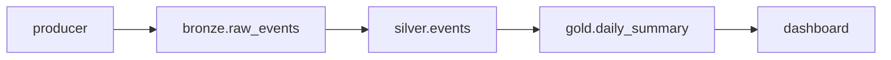
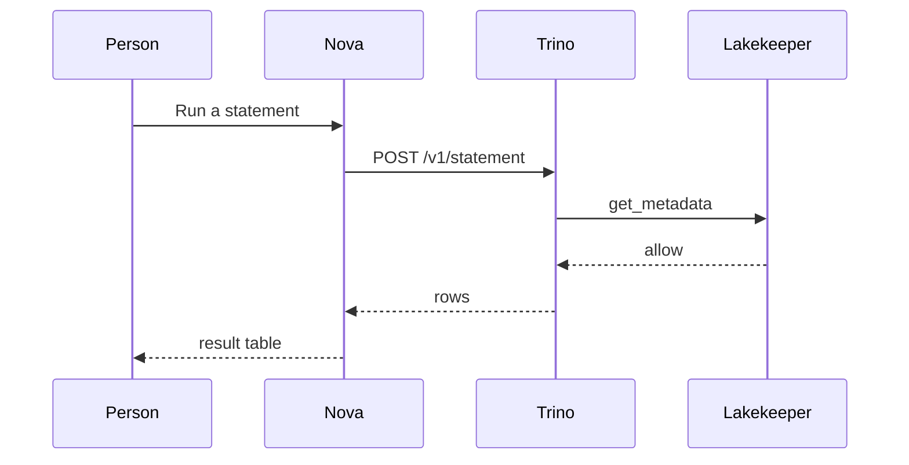
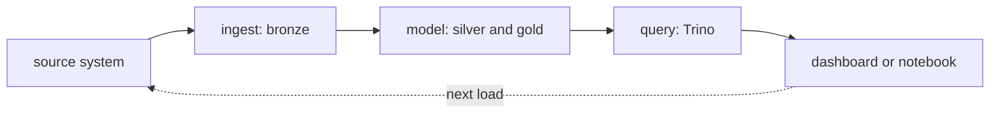

# Diagrams

A diagram is worth a paragraph when it shows a path: where a request goes, what generates what, or
how data moves from a source to a dashboard. The site renders Mermaid, so a diagram is a code block
a reviewer can read in the diff.

## The palette

Every diagram uses the Graphite palette from `docusaurus.config.ts` (`themeConfig.mermaid`):
background `#18191b`, boxes `#282a2e` with a `#3e4147` border, text `#e8eaed`, lines `#8e949e`.
Do not set `style` or `classDef` colours in a page — the theme does that for every diagram, so one
change moves all of them.

## A flow

Rules that keep it readable:

- One direction per diagram: `LR` for a pipeline, `TD` for a hierarchy. Never mix.
- Box labels are the platform's real names, in quotes.
- Subgraphs group by owner (`stardelt-nova`, `stardelt-operator`), not by guesswork.
- At most about twelve nodes; past that, split the diagram.

## A sequence

## The data-flow loop

Use this shape for anything that repeats: a source writes, a pipeline transforms, a dashboard
reads, and the next load starts again.

## Where the renderer is configured

`docusaurus.config.ts` → `themeConfig.mermaid` (theme `base`, the variables above) and
`src/css/custom.css` → `.docusaurus-mermaid-container` (the surface, border and padding around every
diagram). Change one of those, not a page.
