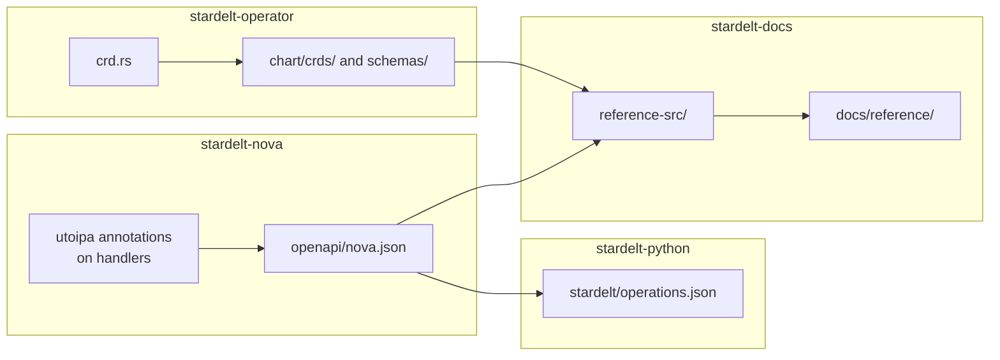

# How it is built

Where things live and how they get generated. For what the platform does, read
[How it works](../architecture/how-it-works) first.

## Where a change goes

| You want to change | Repository | Start at |
|---|---|---|
| An API route | `stardelt-nova` | `backend/src/main.rs` (`api_router`, `admin_router`) |
| A screen | `stardelt-nova` | `frontend/src/App.tsx` (routes), `frontend/src/components/Shell.tsx` (navigation) |
| A resource (`Pipeline`, `Catalog`, …) | `stardelt-operator` | `crates/stardelt-operator/src/crd.rs` |
| What the operator does with a resource | `stardelt-operator` | `controller.rs`, `planner.rs` |
| How a service is configured | `stardelt-platform` and `stardelt-operator` | `helm-values/`, `manifests/`, `chart/`; `crates/stardelt-operator/values/` |
| The install order | `stardelt-platform` | `Makefile` (`step-*`), `scripts/platform.sh` |
| The Python package, command line or MCP tools | `stardelt-python` | `stardelt/` |
| How pipelines run in Airflow | `stardelt-demos` | `dags/pipeline_loader.py`, `dags/stardelt_pipelines/` |

## What is generated

Never edit generated files by hand. Change the source and regenerate, or CI fails.

| File | Comes from | Regenerate with |
|---|---|---|
| `stardelt-nova/openapi/nova.json` | Handler annotations | `UPDATE_OPENAPI=1 cargo test -p stardelt-nova-backend openapi` |
| `stardelt-operator/chart/crds/`, `schemas/` | `crd.rs` | `cargo run --bin crdgen` |
| `stardelt-python/stardelt/operations.json` | Nova's contract on `main` | `python scripts/sync_contract.py` |
| `stardelt-docs/reference-src/`, `docs/reference/` | Both of the above, on `main` | `npm run sync:reference && npm run gen:reference` |

## Three ways to install, one set of versions

The platform can be installed three ways, and each has its own copy of the configuration:

| Path | Lives in | Who it is for |
|---|---|---|
| `make platform`, `make install` | `stardelt-platform/Makefile`, `helm-values/`, `manifests/`, `scripts/` | The complete platform today |
| Umbrella chart | `stardelt-platform/chart/` | One Helm release; the core, sign-in and the applications |
| Operator | `stardelt-operator/crates/stardelt-operator/src/planner.rs`, `values/` | The direction of travel ([milestone v0.2](../roadmap)) |

So a change to how a service runs usually touches more than one place. CI compares the versions
(`scripts/check-version-parity.sh`, `scripts/check-platform-pins.sh`), but it cannot compare behaviour.
Some scripts are copied into the operator, such as `access_sync_job.py`. A copy is a dependency: when you
change the original, change the copy.

## Rules that hold everywhere

- **Group membership is the role.** There are no per-user special cases.
- **No committed credentials and no fixed defaults.** Generate secrets at install, once. CI checks with
  `scripts/check-no-default-secrets.sh`.
- **A token never appears in a URL, a log line or an error message.**
- **Whatever the interface can do, the API can do.** A route is tagged `public` (stable; tools may
  rely on it) or `internal` (for the interface only; it may change). A breaking change to a `public`
  route bumps Nova's version.
- **Your tables stay open.** Nothing writes a private table format or a side channel past the catalog.
- **Upstream stays upstream.** No forks: fixes go to the upstream project. Keep values and glue small.
- **Pin everything.** Chart versions in the `Makefile`, images by digest.
- **Every volume has a backup or a stated reason not to.** `make verify-backups-all` fails on a new
  volume until it does.
- **Licenses:** see the [policy](../architecture/licenses). It covers your dependencies too.
- **`NOVA_AUTH_MODE=dev` keeps working.** CI and demo mode depend on it.
- **A page says what is true now.** See [Document a feature](./recipes#document-a-feature).
